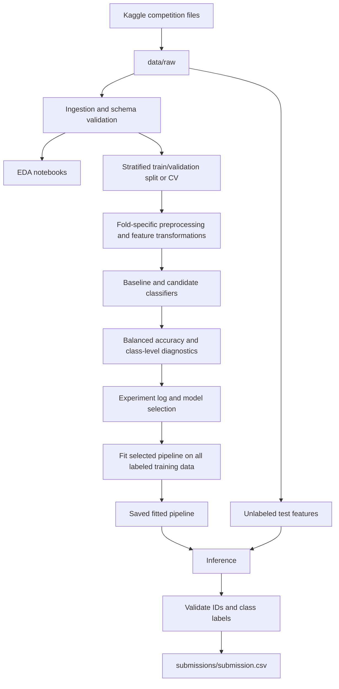

# Project Architecture

**Project:** Predicting Stellar Class  
**Competition:** Kaggle Playground Series, Season 6 Episode 6  
**Problem:** Multiclass classification (`GALAXY`, `STAR`, `QSO`)  
**Primary metric:** Balanced accuracy  
**Tooling:** Python, uv, Jupyter, scikit-learn, JetBrains IDEs, VS Code

## 1. Purpose and architectural principles

This document defines the intended repository layout, responsibilities of each component, data flow, and conventions for the Predicting Stellar Class project. It is a **target architecture**: files and modules may be introduced incrementally as the project progresses.

Core principles:

1. **Separate exploration from reusable logic.** Notebooks are for investigation and reporting; reusable transformations, training, and inference belong in `src/`.
2. **Make experiments reproducible.** Pin dependencies with `uv.lock`, use explicit configurations and random seeds, and record validation results.
3. **Prevent leakage.** Fit imputation, scaling, encoding, selection, and other learned transformations on training folds only.
4. **Keep raw data immutable.** Never overwrite the original Kaggle downloads.
5. **Keep the architecture proportional to the problem.** Build modules when there is real functionality to place in them, rather than generating empty boilerplate.
6. **Maintain consistent training and inference.** Save fitted preprocessing and classification steps together where practical.

## 2. Repository structure

```text
predict_stellar_class/
├── .github/
│   └── workflows/
│       └── ci.yml
├── .gitignore
├── .python-version
├── README.md
├── pyproject.toml
├── uv.lock
├── configs/
│   ├── data.yaml
│   ├── features.yaml
│   └── model.yaml
├── data/
│   ├── raw/
│   │   ├── train.csv
│   │   ├── test.csv
│   │   └── sample_submission.csv
│   ├── interim/
│   ├── processed/
│   └── external/
├── docs/
│   ├── 00_overview/
│   │   └──  00_project_overview.md
│   ├── 01_architecture/
│   │   └──  00_architecture.md
│   ├── data-dictionary.md
│   ├── methodology.md
│   ├── experiment-log.md
│   └── findings.md
├── notebooks/
│   ├── 01_data_ingestion.ipynb
│   ├── 02_exploratory_data_analysis.ipynb
│   ├── 03_feature_engineering.ipynb
│   ├── 04_baseline_modeling.ipynb
│   ├── 05_model_experiments.ipynb
│   └── 06_model_evaluation.ipynb
├── src/
│   └── predict_stellar_class/
│       ├── __init__.py
│       ├── data/
│       │   ├── __init__.py
│       │   ├── ingestion.py
│       │   ├── validation.py
│       │   └── preprocessing.py
│       ├── features/
│       │   ├── __init__.py
│       │   └── engineering.py
│       ├── models/
│       │   ├── __init__.py
│       │   ├── baseline.py
│       │   ├── train.py
│       │   ├── evaluate.py
│       │   └── predict.py
│       ├── utils/
│       │   ├── __init__.py
│       │   ├── config.py
│       │   ├── logging.py
│       │   └── paths.py
│       └── pipelines/
│           ├── __init__.py
│           ├── training.py
│           └── inference.py
├── tests/
│   ├── conftest.py
│   ├── test_ingestion.py
│   ├── test_preprocessing.py
│   ├── test_features.py
│   └── test_predictions.py
├── models/
│   ├── .gitkeep
│   └── README.md
├── reports/
│   ├── figures/
│   │   └── .gitkeep
│   ├── metrics/
│   │   └── .gitkeep
│   └── experiment_results/
│       └── .gitkeep
├── submissions/
│   ├── .gitkeep
│   └── submission_log.md
└── scripts/
    ├── run_eda.py
    ├── train_model.py
    ├── evaluate_model.py
    └── create_submission.py
```

> **Status:** This is the planned structure, not a claim that all files have already been implemented. `docs/architecture.md` is the recommended location for this document.

## 3. Component responsibilities

| Path | Responsibility | Guidance |
| --- | --- | --- |
| `configs/` | Declarative dataset, feature, and model settings | Avoid embedding machine-specific absolute paths. |
| `data/raw/` | Original Kaggle files | Read-only source of truth; ignore in Git. |
| `data/interim/` | Intermediate datasets from exploration or cleaning | Re-creatable; ignore generated files. |
| `data/processed/` | Model-ready derived datasets, if materialized | Record how they were generated; ignore generated files. |
| `data/external/` | Optional external reference data | Document provenance and licensing. |
| `docs/` | Design, methodology, findings, and experiment decisions | Track in Git. |
| `notebooks/` | EDA, hypotheses, comparisons, and visual analysis | Track `.ipynb`; ignore checkpoints. |
| `src/predict_stellar_class/data/` | Loading, schema checks, and reusable preprocessing | Keep training-only fitted transformations inside pipelines. |
| `src/predict_stellar_class/features/` | Reusable feature creation | Distinguish deterministic features from learned transformations. |
| `src/predict_stellar_class/models/` | Model construction, fitting, evaluation, and predictions | Return explicit metrics and outputs. |
| `src/predict_stellar_class/pipelines/` | Orchestrated training and inference workflows | Reuse the same fitted transformation/model bundle. |
| `src/predict_stellar_class/utils/` | Shared paths, logging, and config loading | Avoid circular dependencies and hidden global state. |
| `tests/` | Unit and workflow checks | Use small synthetic fixtures, not full Kaggle datasets. |
| `models/` | Serialized fitted models | Usually generated and ignored. |
| `reports/` | Figures, metrics, and experiment artifacts | Track selected summaries; ignore large/generated artifacts. |
| `submissions/` | Kaggle submission CSVs and submission log | Track the log; decide separately whether to track CSVs. |
| `scripts/` | Thin command-line entry points | Call `src/` functions rather than duplicating business logic. |
| `.github/workflows/` | Optional automated checks | Run tests and linting without private datasets. |

## 4. Data and modeling flow



**Important distinction:** The Kaggle `test.csv` is unlabeled and must not be used to calculate validation accuracy. Any preprocessing that learns statistics from data must be fitted only on the corresponding training fold during validation.

## 5. Notebook workflow

| Notebook | Primary purpose | Typical output |
| --- | --- | --- |
| `01_data_ingestion.ipynb` | Load files, inspect dimensions, columns, types, IDs, duplicates, and missingness | Dataset inventory and initial quality observations |
| `02_exploratory_data_analysis.ipynb` | Analyze target distribution, numeric distributions, relationships, and outliers | EDA findings and plots |
| `03_feature_engineering.ipynb` | Investigate candidate transformations and feature usefulness | Feature hypotheses and reusable feature specifications |
| `04_baseline_modeling.ipynb` | Establish a dummy baseline and simple classifier | Initial cross-validation balanced accuracy |
| `05_model_experiments.ipynb` | Compare algorithms and tuning strategies | Reproducible experiment table |
| `06_model_evaluation.ipynb` | Review confusion matrix, per-class recall, error patterns, and selected model | Model-selection justification |

Notebooks can import from `predict_stellar_class` after the package is installed in the `uv` environment. Avoid copying production transformations across multiple notebooks.

## 6. Evaluation and validation contract

- **Target column:** `class`.
- **Allowed prediction labels:** `GALAXY`, `STAR`, `QSO`.
- **Primary metric:** balanced accuracy, the mean recall across classes.
- **Validation:** prefer a stratified holdout or stratified K-fold cross-validation, with a fixed seed.
- **Baselines:** include `DummyClassifier` and at least one straightforward learned model.
- **Diagnostics:** report a confusion matrix, per-class recall, and class distribution alongside the primary metric.
- **Selection:** choose models based on validation evidence, not Kaggle leaderboard results alone.

Balanced accuracy for three classes is:

\[
\mathrm{BalancedAccuracy} = \frac{\mathrm{Recall}_{GALAXY}+\mathrm{Recall}_{STAR}+\mathrm{Recall}_{QSO}}{3}
\]

A stratified split preserves approximately the same class proportions in each fold, but does not itself prevent preprocessing leakage. Use a scikit-learn `Pipeline` or equivalent fold-safe approach.

## 7. Submission contract

Generate a CSV containing exactly these columns, in order:

```csv
id,class
577347,STAR
577348,GALAXY
577349,STAR
```

Submission generation must:

1. Read the competition test IDs without modifying their order.
2. Generate exactly one predicted class per test row.
3. Check for null predictions and unexpected class labels.
4. Verify row count, unique IDs, and exact column names.
5. Write the CSV without a pandas index (`index=False`).
6. Record model/version, validation score, filename, and submission notes in `submissions/submission_log.md`.

The sample above illustrates formatting only; it is not a model result.

## 8. Configuration and dependency management

- `pyproject.toml` defines project metadata, Python compatibility, runtime and development dependencies, and tool settings.
- `uv.lock` is committed to Git for reproducibility.
- `.python-version` communicates the intended local Python version.
- `configs/data.yaml` can hold relative input/output paths and column names.
- `configs/features.yaml` can hold feature inclusion/exclusion rules.
- `configs/model.yaml` can hold model type, hyperparameters, validation seed, and experiment settings.

Suggested environment commands:

```bash
uv sync
uv run python -m pytest
```

The test command assumes `pytest` is configured as a development dependency. If the project uses a `src/` layout, configure the package as installable in `pyproject.toml` so imports work consistently from notebooks, scripts, and tests.

## 9. Module boundaries

The intended dependency direction is:

```text
scripts / notebooks
        |
        v
pipelines (orchestration)
        |
        +--> data (loading and validation)
        +--> features (transformations)
        +--> models (training, scoring, inference)
        +--> utils (shared support)
```

Avoid importing notebook code into `src/`, importing `scripts/` from library modules, or making `models/` depend on submission file formatting. Each component should have a small, testable public interface.

## 10. Testing and quality checks

Recommended tests include:

- **Ingestion:** required columns exist; target and ID columns are identified correctly.
- **Preprocessing:** transforms handle missing values and retain consistent columns across training and inference.
- **Features:** deterministic calculations produce expected results on small fixtures.
- **Evaluation:** balanced accuracy calculations match expected values on known labels.
- **Predictions:** output length matches input length and predictions belong to the allowed classes.
- **Submission:** `id,class` header, no index column, no missing values, correct row order.

CI should use small synthetic test data so it does not require Kaggle credentials or downloaded competition files.

## 11. Git and artifact policy

**Track:** source code, tests, notebooks, docs, configurations, `pyproject.toml`, `uv.lock`, and selected small experiment summaries.

**Ignore:** `.venv/`, Python caches, `.ipynb_checkpoints/`, machine-specific JetBrains/VS Code state, secrets, raw/processed competition datasets, serialized models, and bulky generated outputs. Preserve empty directories with `.gitkeep` where useful.

Do not commit Kaggle API credentials or private tokens. Never assume an ignored directory's files will be available to CI or collaborators; document the download and regeneration steps instead.

## 12. Implementation phases

| Phase | Scope | Exit condition |
| --- | --- | --- |
| 1. Foundation | Repository, `uv`, docs, Git ignore rules, data download | Dataset loads locally; environment is reproducible |
| 2. Data understanding | Ingestion notebook, EDA, data dictionary | Data quality and class distribution documented |
| 3. Baselines | Validation strategy, dummy and simple classifier | Repeatable balanced-accuracy baseline |
| 4. Feature and model experiments | Reusable transforms, candidate models, experiment log | Candidate models compared fairly |
| 5. Final evaluation | Error analysis, model selection, full-data fit | Selected pipeline and metrics documented |
| 6. Submission | Test inference, validation checks, CSV generation | Submission file passes local format checks |
| 7. Hardening (optional) | Tests, CI, refactoring, documentation | Workflow can be rerun from a clean environment |

## 13. Scope boundaries

This is a **Kaggle tabular classification project**, not a production inference service. A web API, model registry, container deployment, monitoring service, and cloud infrastructure are intentionally out of scope unless a later project goal requires them.

The competition's submission window has closed; the project can still serve as a reproducible applied ML exercise. Prioritize clear reasoning, trustworthy validation, and documented experiments over architectural ceremony.
